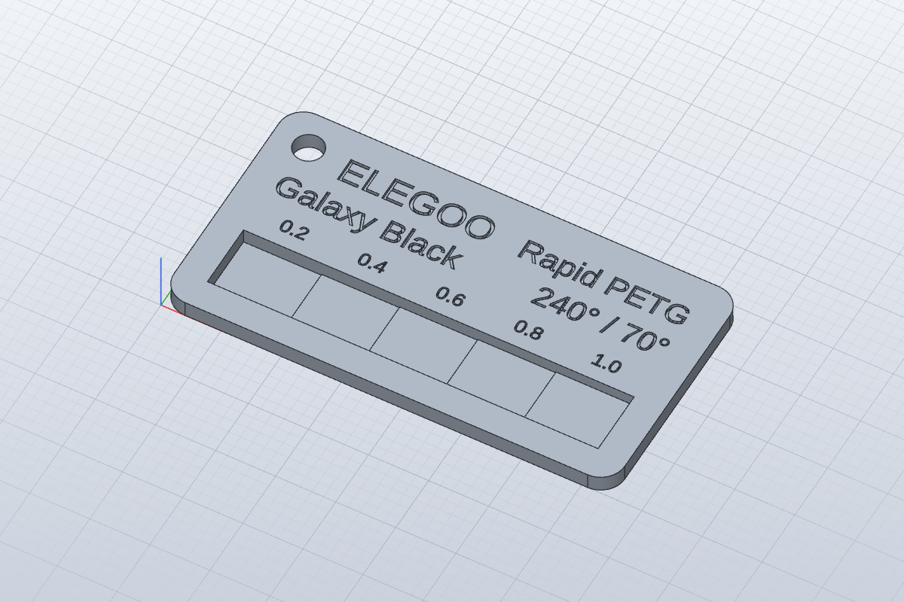
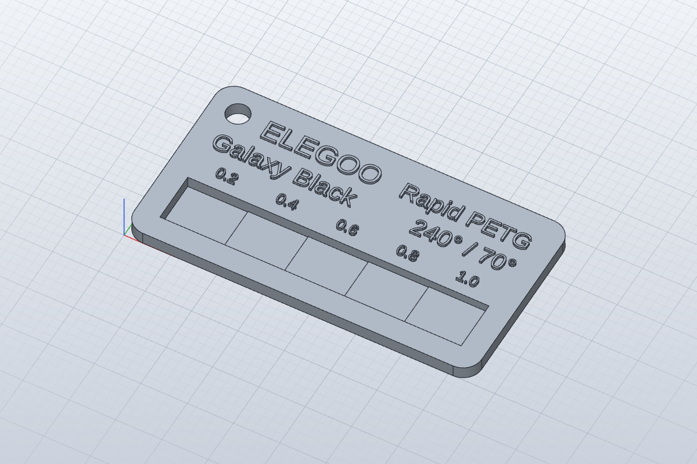
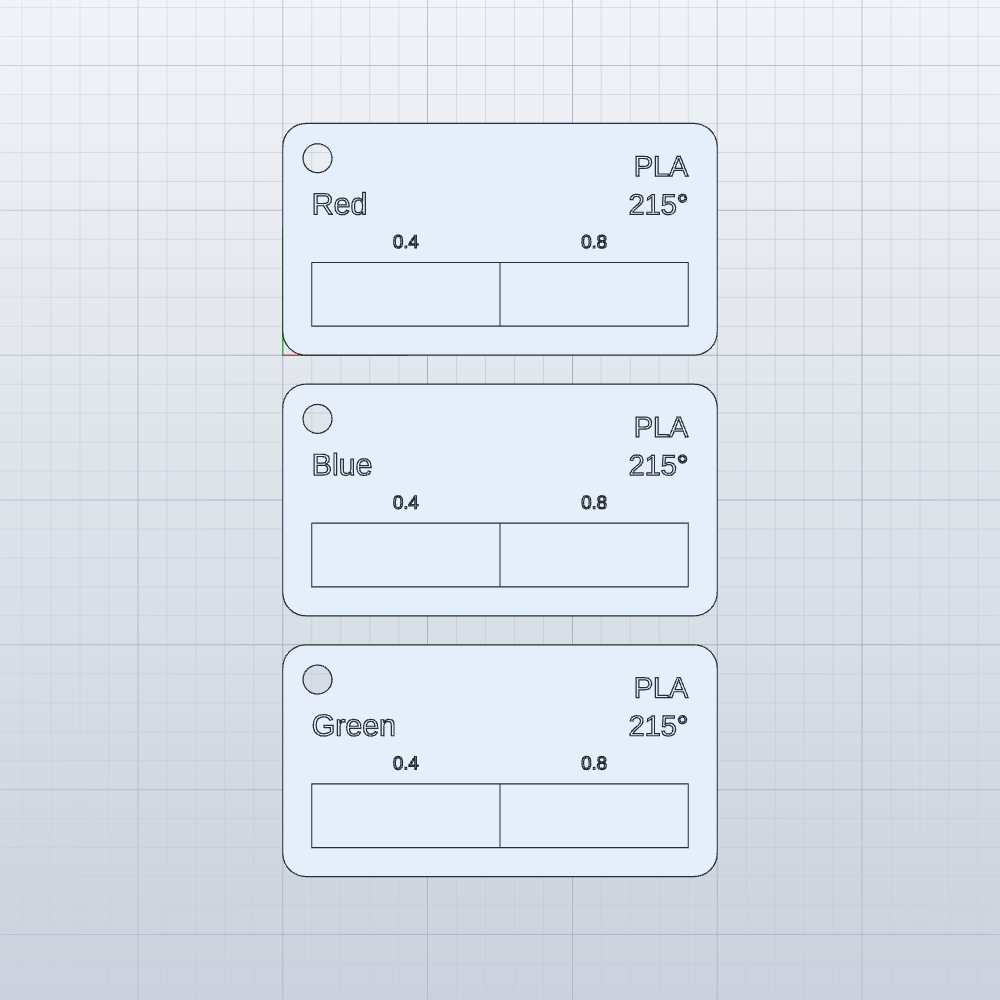
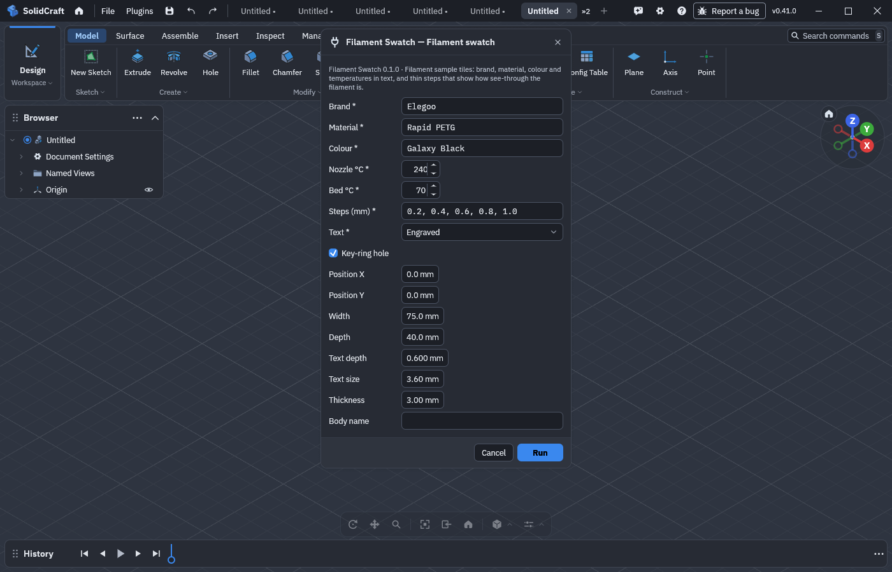

# Filament Swatch for SolidCraft

A [SolidCraft](https://github.com/tangency-labs/solidcraft) plugin that makes filament sample
tiles: brand, material, colour and print temperatures in text, and a row of thin steps that show
how see-through the filament is at each thickness. Print one per spool and hang them on a ring.

Everything it makes is ordinary SolidCraft features (sketches and extrudes), so you can edit the
swatch afterwards like anything you drew yourself. They go in one folder in the History bar, named
like the swatch.

| A swatch with engraved text | Raised text |
|---|---|
|  |  |

| Three colours in one run | The form in SolidCraft |
|---|---|
|  |  |

## What it makes
- A 75 × 40 × 3 mm tile with rounded corners (size and thickness can be changed) and a 5 mm
  key-ring hole.
- The brand in capitals and the material on the top line; the colour and the nozzle and bed
  temperatures under it.
- Thin steps along the bottom, by default 0.2, 0.4, 0.6, 0.8 and 1.0 mm, each labelled with its
  thickness.
- Text engraved into the top or raised from it.
- Several colours separated by `;` (`Red; Blue; Green`) make one swatch each, in a column.

> Status: early (0.3.1). Tested with SolidCraft 0.43.0, 0.44.1 and 0.45.0 on Linux. On macOS, use SolidCraft
> 0.43 or newer: 0.41 and 0.42 crash there when any plugin runs
> ([SolidCraft issue #16698](https://github.com/tangency-labs/solidcraft/issues/16698), fixed in 0.43).

## Install
Download `filament-swatch-0.3.1.zip` from the [latest release](../../releases/latest), then in
SolidCraft: **Plugins › Install plugin…** and pick the zip. Run it from **Plugins › Filament
swatch…**, or its **Swatch** button in the ribbon (with its own icon from SolidCraft 0.44).

## Text takes time
SolidCraft cuts text letter by letter, and a plugin gets 30 seconds a run. A swatch with
"ELEGOO", "Rapid PETG", "Galaxy Black", "240° / 70°" and five step labels (49 letters and digits)
takes about 13 seconds in `solidcraft-cli` and about 23 in the desktop app. So one run takes at most
55 letters and digits of text (spaces are free): with more, the plugin says so before it starts.
Make long colour names shorter, or run several colours one at a time.

It also checks that the two texts on a line fit side by side, from an estimate of the built-in
font's letter widths.

## Parameters
| Key | Form | Default |
|---|---|---|
| `brand` | Brand | Elegoo |
| `material` | Material | PLA |
| `color` | Colour (several separated by `;`) | Black |
| `nozzle_temp`, `bed_temp` | Nozzle °C, Bed °C (0: not shown) | 0 |
| `steps` | Steps (mm), e.g. `0.2, 0.4, 0.6` (up to 8; empty for none) | 0.2, 0.4, 0.6, 0.8, 1.0 |
| `text_style` | Text: "Engraved" or "Raised" | Engraved |
| `hole` | Key-ring hole | true |
| `size_x`, `size_y` | Width 50–200 mm, Depth 38–100 mm | 75, 40 |
| `thickness` | Thickness 1–10 mm | 3 |
| `text_height` | Text size 2–8 mm (capital height of the colour line) | 3.6 |
| `text_depth` | Text depth 0.2–2 mm | 0.6 |
| `position_x`, `position_y` | Corner of the first swatch (mm) | 0 |
| `title` | Body name | Swatch and the colour |

From a script, inspect the package to get its approval hash, then run the `swatch` entry:

```json
{"commands": [
  {"command": "plugin.run", "params": {
    "path": "/path/to/plugins/filament-swatch", "approval": "<hash from plugin.inspect>", "entry": "swatch",
    "params": {"brand": "Elegoo", "material": "Rapid PETG", "color": "Galaxy Black", "nozzle_temp": 240, "bed_temp": 70}}}
]}
```

## Build
Needs Rust with the `wasm32-unknown-unknown` target and `wasm-tools`. `./build.sh` runs the tests,
builds the WebAssembly component and writes `package/filament-swatch-<version>.zip`.

`package/filament-swatch/tests/` holds test cases for SolidCraft 0.45 and later. `solidcraft-cli plugin test package/filament-swatch` runs each one on the real host and checks the body count and volume. The tests are left out of the zip.

## Licence
MIT, see [LICENSE](LICENSE). The plugin interface in `plugin/wit/` is SolidCraft's (Apache 2.0),
see [NOTICE](NOTICE).
